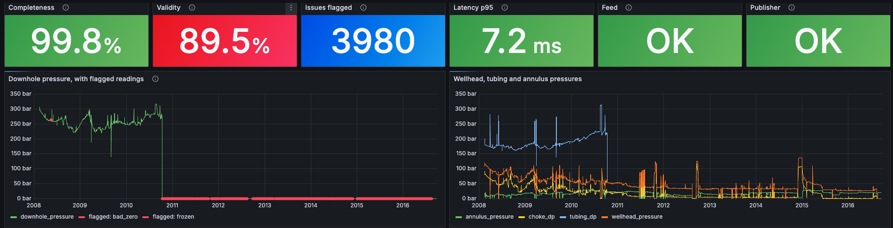
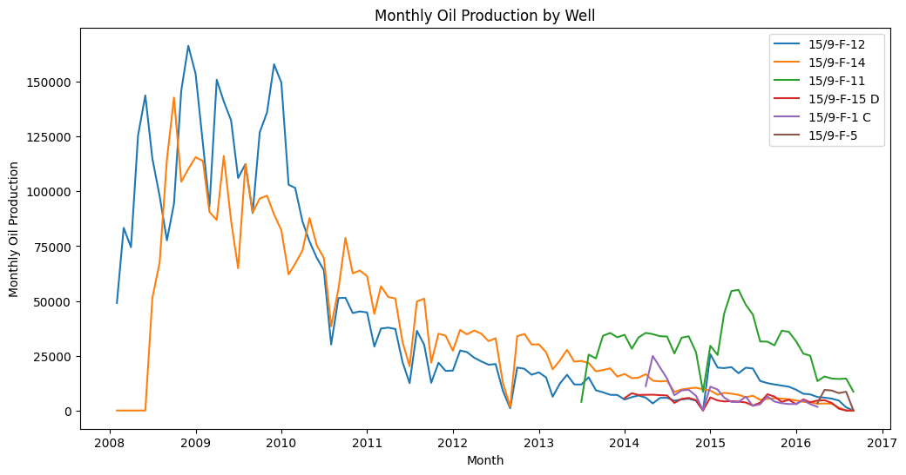
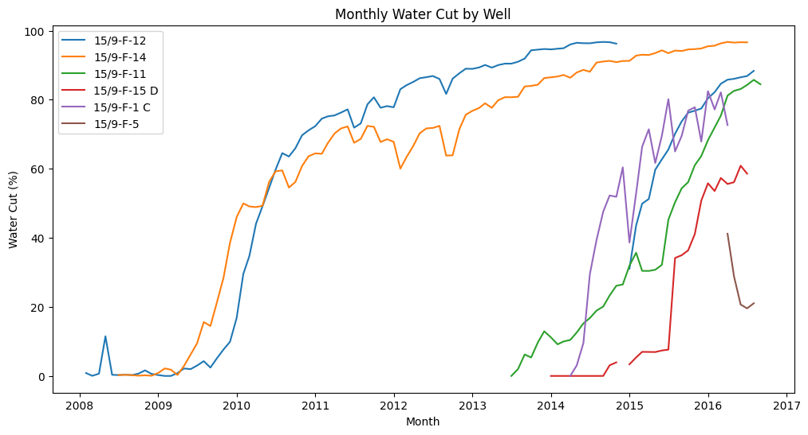
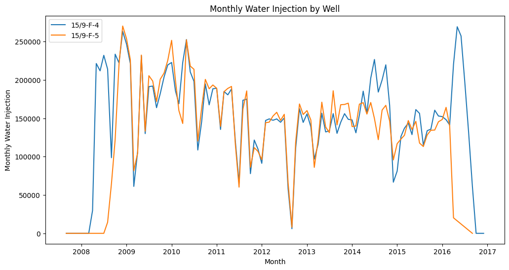
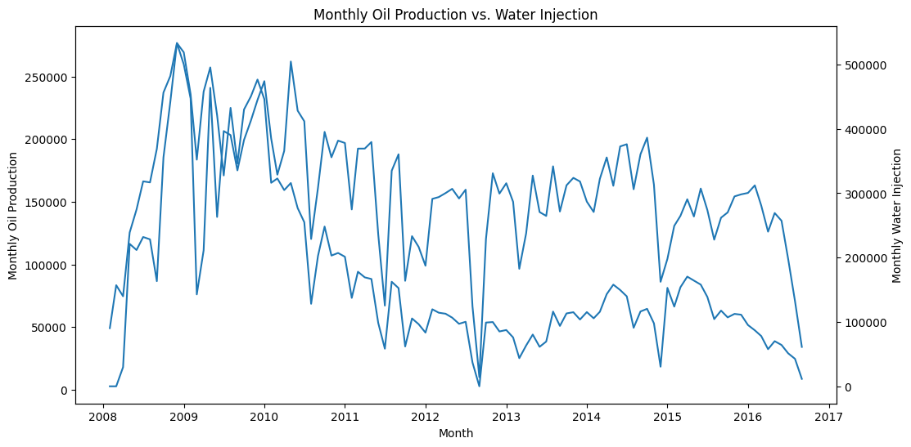
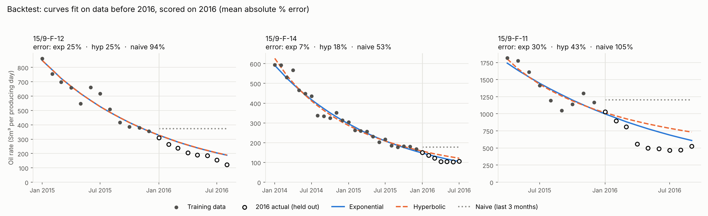
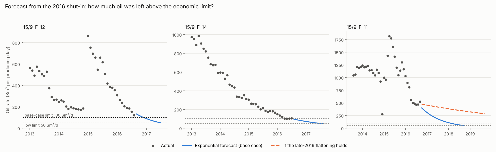

# Volve Field Production Analytics

Production analytics on Equinor's **Volve oil field** in the Norwegian North Sea (2007–2016): which wells carried the field, how it changed as it matured, how water injection relates to oil output, and how much oil was left when it shut in. The same data is also replayed as a live sensor feed with a data-quality monitor, the way an operator's historian would receive it.

**Tools:** Python (pandas, NumPy, SciPy, Matplotlib), Jupyter, SQL (SQLite), MQTT (Mosquitto), Telegraf, InfluxDB, Grafana, Docker

## Highlights

- **Found a dead downhole gauge.** Replaying nine years of data through the real-time quality monitor flagged F-12's downhole pressure and temperature reading exactly 0 for **1,907 producing days** (Oct 2010 to Aug 2016), on the field's biggest well. ([details](realtime/README.md))
- **Forecast each well's decline and backtested it.** A simple exponential curve on a recent window predicted 2016 within **7–30%** per well, against **53–105%** for a naive "same as last quarter" baseline.
- **Estimated the oil left at shut-in.** F-12 and F-14 were at or near the economic limit; **F-11 held almost all the remaining oil** (~100,000 Sm³ base case). ([details](#5-decline-curves-and-remaining-oil))
- **Stress-tested a correlation instead of just reporting it.** The injection/production link got *stronger* (0.55 → 0.76) after removing shutdown months, so shutdowns weren't faking it.
- **Built the pipeline end to end:** Excel → pandas → SQLite with 10 data-quality checks → MQTT → InfluxDB → Grafana, all in Docker.


*The live Grafana dashboard for F-12 after replaying 2008–2016. Downhole pressure (left) drops to 0 in October 2010 and every later reading is flagged (red), which is why validity is only 89.5%.*

**Status:**

| Stage | Status |
|---|---|
| Data cleaning, KPI engineering, exploratory analysis (notebook) | ✅ Done |
| SQLite layer: schema, data-quality checks, analytical views | ✅ Done |
| Real-time layer: MQTT feed, InfluxDB historian, Grafana dashboard, data-quality monitor ([`realtime/`](realtime/README.md)) | ✅ Done |
| Decline curve forecasting with backtest (`notebooks/02_decline_curve_analysis.ipynb`) | ✅ Done |

---

## Business questions

1. Which wells drove field production, and which were the most reliable?
2. How did oil, gas, and water output change for each well over the field's life?
3. How well did the two water-injection wells perform?
4. Is water injection associated with oil production, and does the relationship hold with a time lag?
5. Can a decline curve forecast each well, and how much oil was left when the field shut in?

---

## Dataset

| | |
|---|---|
| **Source** | Equinor Volve Data Village, released under the Equinor Open Data Licence |
| **Raw file** | `data/raw/Volve production data.xlsx`, sheet *Daily Production Data* |
| **Size** | 15,634 daily records × 24 columns |
| **Date range** | Sep 2007 – Dec 2016 |
| **Wells** | 7 wellbores: 6 used as oil producers (F-1 C, F-11, F-12, F-14, F-15 D, F-5) and 2 as water injectors (F-4, F-5) |

F-5 switched from water injector to oil producer in 2016, and F-1 C appears as both types, so records are split by `WELL_TYPE` **and** `FLOW_KIND` rather than by well name alone.

Data © Equinor, used with attribution under the Equinor Open Data Licence.

---

## Data preparation

- Split records into **production** (`WELL_TYPE = OP`, `FLOW_KIND = production`: 9,143 rows) and **injection** (`WELL_TYPE = WI`, `FLOW_KIND = injection`: 6,473 rows).
- Set negative water volumes to missing (`NaN`), since they are physically invalid.
- Engineered KPI columns:

| KPI | Formula |
|---|---|
| Uptime % | `ON_STREAM_HRS / 24 × 100` (capped at 100) |
| Water cut % | `water / (oil + water) × 100` |
| Oil rate (24h-normalized) | `oil volume / on-stream hours × 24` |
| Gas rate (24h-normalized) | `gas volume / on-stream hours × 24` |
| Injection rate (24h-normalized) | `water injected / on-stream hours × 24` |

- Rolled daily data up to **monthly** totals per well for trend analysis.

---

## Key findings

### 1. Well performance

| Well | Total oil (Sm³) | Avg uptime | Avg water cut | Avg oil rate (Sm³/day) |
|---|---:|---:|---:|---:|
| 15/9-F-12 | 4.58M | 88.9% | 59.6% | 1,678 |
| 15/9-F-14 | 3.94M | 85.6% | 65.1% | 1,508 |
| 15/9-F-11 | 1.15M | **93.0%** | 38.3% | 1,051 |
| 15/9-F-1 C | 0.18M | 55.8% | 51.1% | 415 |
| 15/9-F-15 D | 0.15M | 76.0% | **19.3%** | 201 |
| 15/9-F-5 | 0.04M | 83.3% | 24.5% | 319 |

- **F-12 and F-14 produced about 85% of the field's ~10M Sm³ of oil.** F-12 led on both oil and gas.
- **F-11 was the most reliable producer**, with the highest average uptime (~93%).
- **F-1 C had the weakest availability**, on stream only about half the time.
- Low water cut alone did not mean a good well: **F-15 D** had the lowest water cut but also the lowest oil rate.

### 2. Production decline and rising water cut



- F-12 and F-14 dominated early production, then went into long-term decline. **F-11 became a major contributor later in the field's life** (from 2013).



- Water cut on F-12 and F-14 rose from near 0% to **over 90%**, mirroring their oil decline. F-11 followed the same pattern later, passing 80% by 2016. The field became increasingly water-dominated as it matured.

Gas production followed the same pattern as oil: see `images/monthly_gas_by_well.png`.

### 3. Water injection

| Injector | Total water injected (Sm³) | Avg uptime | Avg injection rate (Sm³/day) | Zero on-stream days |
|---|---:|---:|---:|---:|
| 15/9-F-4 | 16.24M | 84.3% | 6,045 | 345 |
| 15/9-F-5 | 14.09M | 80.0% | 5,841 | 466 |



- **F-4 was the stronger and more consistent injector**, injecting more water with fewer days offline.

### 4. Production vs. injection



| Relationship | Correlation |
|---|---:|
| Same month | **0.55** |
| Injection → oil 1 month later | 0.35 |
| Injection → oil 3 months later | 0.18 |

- Oil production and water injection moved together most strongly **in the same month**, and the link weakened with longer lags.

**Robustness check (SQL, `vw_injection_correlation`).** Two things could create a correlation that means nothing: field-wide shutdowns (both series drop to near zero together) and a shared long-term decline. I tested both:

| Sample | Months | Correlation |
|---|---:|---:|
| All months | 104 | 0.55 |
| Only months with average producer uptime ≥ 90% | 49 | **0.76** |
| Month-over-month changes (long-term trend removed) | 103 | **0.71** |

- The link got **stronger**, not weaker, once shutdown months or the long-term trend were removed. Neither shutdowns nor the field's overall decline explain it.
- It is still an association, not proof that injection raised production. On a platform, injection is often adjusted to match what is being produced (to replace the volume taken out of the reservoir), which would create the same pattern. Separating the two would need reservoir pressure data.

### 5. Decline curves and remaining oil

Notebook: `notebooks/02_decline_curve_analysis.ipynb` · code: `python/decline_curves.py`

**Method.** Monthly oil rate per *producing* day (so shutdowns don't look like decline), fit with Arps exponential and hyperbolic curves in log space. Each fit starts at the peak after the well's last restart and looks back at most 24 months.

**Backtest:** fit on data before 2016, scored on 2016 (mean absolute % error on monthly rate).



| Well | Fit from | Exponential | Hyperbolic | Naive (last 3 months held flat) |
|---|---|---:|---:|---:|
| 15/9-F-12 | 2015-01 | **25%** | 25% | 94% |
| 15/9-F-14 | 2014-01 | **7%** | 18% | 53% |
| 15/9-F-11 | 2015-04 | **30%** | 43% | 105% |

- **Both curves beat the naive baseline on every well**, and the simpler exponential matched or beat the hyperbolic every time. With 9–24 monthly points, the extra parameter mostly fits noise.
- **The fit window mattered more than the model.** Fitting F-14 from its 2008 peak instead of the last 24 months raised the error from 7% to 65%, because its decline steepened as water cut rose.
- **F-12 needed a restart rule.** Its rate jumped from ~180 to ~860 Sm³/d in January 2015 after a shut-in (probably a well intervention; the data doesn't record it), so fitting across that jump would be meaningless.
- **Where it missed:** F-12 and F-11 declined faster in 2016 than predicted. F-11 lost 31% of its rate in a single month (April 2016), a step change no smooth curve anticipates.

**Remaining oil at the 2016 shut-in** (exponential, refit on all data; calendar volumes use each well's last-12-month uptime, ~93%). The dataset has no cost data, so the economic limit is an assumption, shown at three levels (Sm³):

| Well | Last rate (Sm³/d) | Annual decline | Limit 50 Sm³/d | **Limit 100 Sm³/d** | Limit 150 Sm³/d |
|---|---:|---:|---:|---:|---:|
| 15/9-F-12 | 121 | 69% | 25,200 | **10,300** | 0 |
| 15/9-F-14 | 106 | 50% | 24,300 | **0** | 0 |
| 15/9-F-11 | 527 | 65% | 118,500 | **101,700** | 87,600 |
| **Total** | | | 168,000 | **112,000 (~0.7 MMbbl)** | 87,600 |



- **F-12 and F-14 were finished.** F-14 was already at ~100 Sm³/d and F-12 would have reached it within about three months.
- **F-11 was the only well with meaningful oil left.** The base case is about 100,000 Sm³. But F-11's rate held flat at ~470–530 Sm³/d for its last six months; if that was the new normal, the estimate rises to about **737,000 Sm³**. That one judgment call moves the answer 7×, so I report it as a range rather than a single number.
- **In context:** the base case is about 1% of what these three wells had already produced.

**Limits.** No reservoir pressure (and F-12's downhole gauge was dead from 2010, as the real-time monitor found), no cost data, no intervention records, and no platform constraints such as water handling. This is a first-pass screen, not a reserves estimate.

---

## SQL layer (`sql/`, SQLite)

`python/load_sqlite.py` builds `data/volve.db` from the cleaned producer data and the raw injector records, runs the data-quality checks, and creates the views.

| Object | Purpose |
|---|---|
| `wells` | One row per wellbore and role (F-5 and F-1 C appear as both producer and injector) |
| `daily_production` | Fact table: one row per producer per day, with KPI columns |
| `daily_injection` | Fact table: one row per injector per day |
| `data_quality_log` | Results of the 10 checks in `02_checks.sql` |
| `vw_well_kpis` | Totals, share of field oil, uptime, and water cut both volume-weighted and as a daily average |
| `vw_injector_kpis` | Injection totals, uptime, rates, offline days |
| `vw_field_monthly` | Field oil, gas, water, water cut and uptime by month |
| `vw_water_cut_milestones` | First month each well crossed 50%, 80% and 90% water cut |
| `vw_downtime_by_well_year` | Offline days, partial days and hours lost per well per year |
| `vw_prod_vs_injection` | Monthly field oil vs. injection with uptime |
| `vw_injection_correlation` | The robustness check above, computed in SQL |

**Data-quality results**

| Check | Issues | Severity |
|---|---:|---|
| Duplicate well-days | 0 | error |
| Negative volumes (producers) | 0 | error |
| Negative injection volumes | 0 | error |
| On-stream hours above 24 | 13 | warning |
| Oil produced with 0 on-stream hours | 1 | warning |
| Oil rate from under 2 on-stream hours | 29 | warning |
| Missing water volume (after negatives set to NULL) | 4 | warning |
| Gaps in a well's daily timeline | 101 | warning |
| Injector days with no on-stream hours recorded | 285 | warning |
| Producer days fully offline | 1,132 | info |

- **Short run times inflate rates.** Normalizing a few minutes of flow to 24 hours gives unrealistic oil rates, so the SQL KPIs average rates only over days with at least 2 on-stream hours.
- **Two ways to measure water cut.** The notebook averages daily ratios; `vw_well_kpis` also reports the volume-weighted value (total water ÷ total liquid). They differ most on F-11 (38% vs. 49%), because its water-heavy late-life days carry more volume.

**Water cut milestones (`vw_water_cut_milestones`)**

| Well | Online | Water cut ≥ 50% | ≥ 80% | ≥ 90% |
|---|---|---|---|---|
| 15/9-F-12 | 2008-02 | 2010-06 | 2011-10 | 2013-03 |
| 15/9-F-14 | 2008-02 | 2010-06 | 2013-06 | 2014-08 |
| 15/9-F-1 C | 2014-04 | 2014-10 | 2015-07 | — |
| 15/9-F-15 D | 2014-01 | 2015-12 | — | — |
| 15/9-F-11 | 2013-07 | 2015-08 | 2016-04 | — |

F-12 went from first oil to 90% water in about five years. F-1 C crossed 50% within six months of coming online.

---

## Possible extensions

1. **Water-oil ratio forecasting:** for a waterflooded field, water-oil ratio against cumulative oil is often a steadier predictor than rate against time, and could explain the accelerating declines.
2. **Field-level economic limit:** on an offshore platform the fixed cost is shared, so the real shut-in point is a field-level decision, not a per-well one.

---

## Project structure

```
volve-production-analytics/
├── data/
│   ├── raw/
│   │   └── Volve production data.xlsx
│   ├── processed/
│   │   ├── production_daily_clean.csv   ← daily producer records + KPI columns
│   │   ├── monthly_production.csv       ← monthly totals per producing well
│   │   ├── monthly_injection.csv        ← monthly totals per injector
│   │   └── decline_*.csv                ← backtest, forecast and F-11 sensitivity results
│   └── volve.db                         ← built by python/load_sqlite.py (not committed)
├── images/                              ← charts exported from the notebook
├── notebooks/
│   ├── 01_data_cleaning_eda.ipynb
│   └── 02_decline_curve_analysis.ipynb
├── python/
│   ├── load_sqlite.py
│   └── decline_curves.py
├── sql/
│   ├── 01_schema.sql
│   ├── 02_checks.sql
│   └── 03_views.sql
├── realtime/                            ← live sensor feed + data-quality monitor (see realtime/README.md)
└── README.md
```

## How to run

```
pip install pandas numpy scipy matplotlib openpyxl jupyter

# Notebook
cd notebooks
jupyter notebook 01_data_cleaning_eda.ipynb

# SQL layer (from the project folder)
python python/load_sqlite.py
sqlite3 data/volve.db "SELECT * FROM vw_well_kpis;"

# Decline curves (rebuilds the decline_*.csv results and both charts)
python python/decline_curves.py
```
