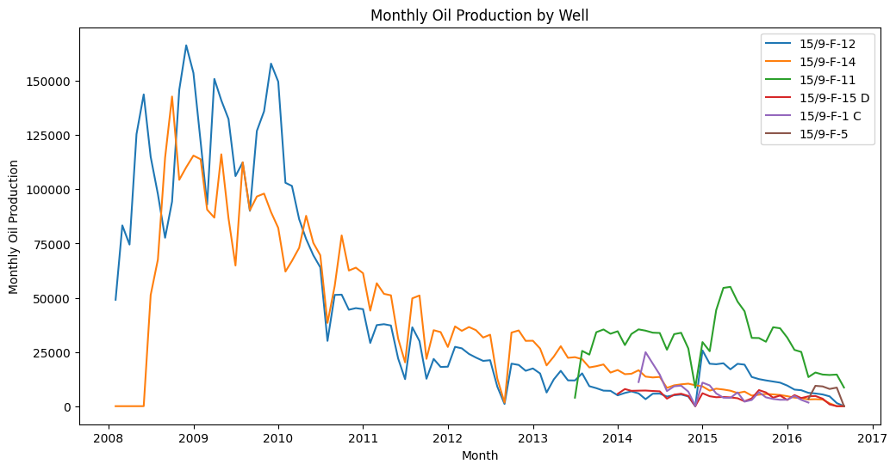
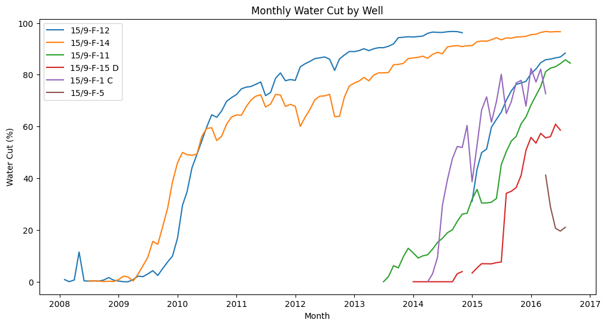
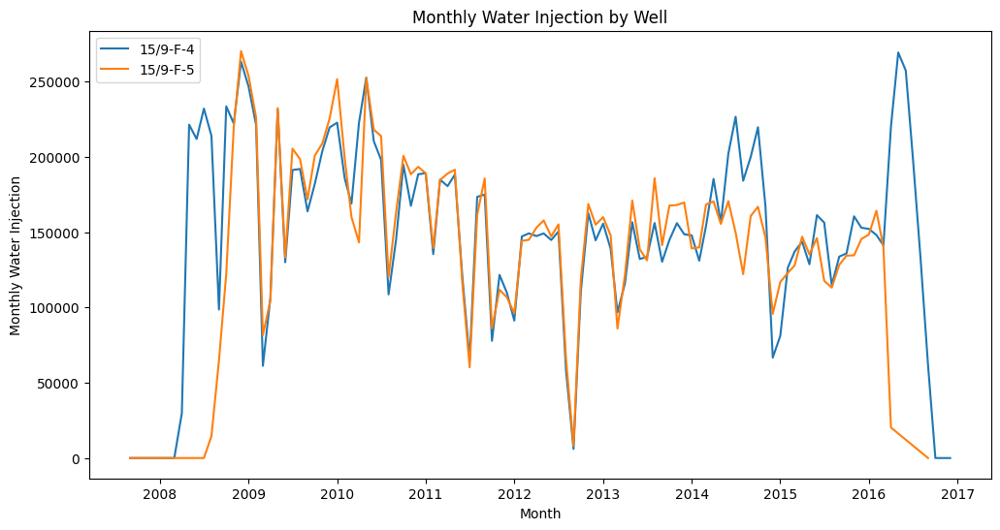
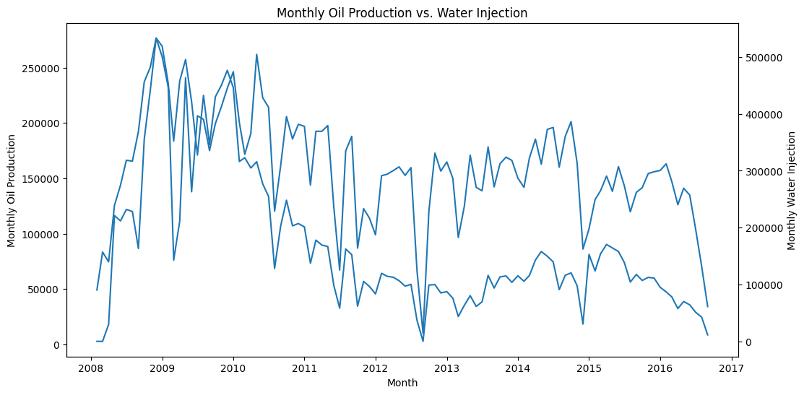

# Volve Field Production Analytics

Exploratory analysis of daily production and water-injection data from Equinor's **Volve oil field** in the Norwegian North Sea (2007–2016). The project asks which wells carried the field, how the field changed as it matured, and how water injection relates to oil output.

**Tools:** Python (pandas, NumPy, Matplotlib), Jupyter

**Status:** Exploratory analysis complete. Decline curve forecasting is next (see [Next steps](#next-steps)).

---

## Business questions

1. Which wells drove field production, and which were the most reliable?
2. How did oil, gas, and water output change for each well over the field's life?
3. How well did the two water-injection wells perform?
4. Is water injection associated with oil production, and does the relationship hold with a time lag?

---

## Dataset

| | |
|---|---|
| **Source** | Equinor Volve Data Village, released under the Equinor Open Data Licence |
| **Raw file** | `data/raw/Volve production data.xlsx`, sheet *Daily Production Data* |
| **Size** | 15,634 daily records × 24 columns |
| **Date range** | Sep 2007 – Dec 2016 |
| **Wells** | 7 wellbores: 6 used as oil producers (F-1 C, F-11, F-12, F-14, F-15 D, F-5) and 2 as water injectors (F-4, F-5) |

F-5 switched from water injector to oil producer in 2016, and F-1 C appears as both types, so records are split by `WELL_TYPE` **and** `FLOW_KIND` rather than by well name alone.

Data © Equinor, used with attribution under the Equinor Open Data Licence.

---

## Data preparation

- Split records into **production** (`WELL_TYPE = OP`, `FLOW_KIND = production`: 9,143 rows) and **injection** (`WELL_TYPE = WI`, `FLOW_KIND = injection`: 6,473 rows).
- Set negative water volumes to missing (`NaN`), since they are physically invalid.
- Engineered KPI columns:

| KPI | Formula |
|---|---|
| Uptime % | `ON_STREAM_HRS / 24 × 100` (capped at 100) |
| Water cut % | `water / (oil + water) × 100` |
| Oil rate (24h-normalized) | `oil volume / on-stream hours × 24` |
| Gas rate (24h-normalized) | `gas volume / on-stream hours × 24` |
| Injection rate (24h-normalized) | `water injected / on-stream hours × 24` |

- Rolled daily data up to **monthly** totals per well for trend analysis.

---

## Key findings

### 1. Well performance

| Well | Total oil (Sm³) | Avg uptime | Avg water cut | Avg oil rate (Sm³/day) |
|---|---:|---:|---:|---:|
| 15/9-F-12 | 4.58M | 88.9% | 59.6% | 1,678 |
| 15/9-F-14 | 3.94M | 85.6% | 65.1% | 1,508 |
| 15/9-F-11 | 1.15M | **93.0%** | 38.3% | 1,051 |
| 15/9-F-1 C | 0.18M | 55.8% | 51.1% | 415 |
| 15/9-F-15 D | 0.15M | 76.0% | **19.3%** | 201 |
| 15/9-F-5 | 0.04M | 83.3% | 24.5% | 319 |

- **F-12 and F-14 produced about 85% of the field's ~10M Sm³ of oil.** F-12 led on both oil and gas.
- **F-11 was the most reliable producer**, with the highest average uptime (~93%).
- **F-1 C had the weakest availability**, on stream only about half the time.
- Low water cut alone did not mean a good well: **F-15 D** had the lowest water cut but also the lowest oil rate.

### 2. Production decline and rising water cut



- F-12 and F-14 dominated early production, then went into long-term decline. **F-11 became a major contributor later in the field's life** (from 2013).



- Water cut on F-12 and F-14 rose from near 0% to **over 90%**, mirroring their oil decline. F-11 followed the same pattern later, passing 80% by 2016. The field became increasingly water-dominated as it matured.

Gas production followed the same pattern as oil: see `images/monthly_gas_by_well.png`.

### 3. Water injection

| Injector | Total water injected (Sm³) | Avg uptime | Avg injection rate (Sm³/day) | Zero on-stream days |
|---|---:|---:|---:|---:|
| 15/9-F-4 | 16.24M | 84.3% | 6,045 | 345 |
| 15/9-F-5 | 14.09M | 80.0% | 5,841 | 466 |



- **F-4 was the stronger and more consistent injector**, injecting more water with fewer days offline.

### 4. Production vs. injection



| Relationship | Correlation |
|---|---:|
| Same month | **0.55** |
| Injection → oil 1 month later | 0.35 |
| Injection → oil 3 months later | 0.18 |

- Oil production and water injection moved together most strongly **in the same month**, and the link weakened with longer lags.
- This is an association, not proof of cause. Field-wide shutdowns (for example mid-2011 and Sep 2012) drop both series at once, and well availability and reservoir maturity affect both.

---

## Next steps

1. **Decline curve analysis:** fit Arps exponential/hyperbolic curves to F-12, F-14, and F-11, backtest against held-out 2016 data, and estimate remaining production per well.
2. **Uptime-controlled injection check:** re-run the injection correlation excluding low-uptime months to separate the shutdown effect.
3. **Dashboard:** well KPIs, monthly trends, and a well filter.

---

## Project structure

```
volve-production-analytics/
├── data/
│   ├── raw/
│   │   └── Volve production data.xlsx
│   └── processed/
│       ├── production_daily_clean.csv   ← daily producer records + KPI columns
│       ├── monthly_production.csv       ← monthly totals per producing well
│       └── monthly_injection.csv        ← monthly totals per injector
├── images/                              ← charts exported from the notebook
├── notebooks/
│   └── 01_data_cleaning_eda.ipynb
└── README.md
```

## How to run

```
pip install pandas numpy matplotlib openpyxl jupyter
cd notebooks
jupyter notebook 01_data_cleaning_eda.ipynb
```
