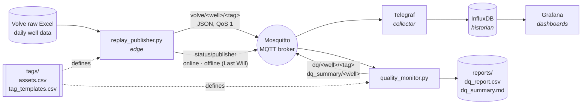

# Architecture

## Data flow



| Layer | Component | Industrial equivalent |
|---|---|---|
| Source | Volve daily well records (Excel) | Instruments, PLC/SCADA, a vendor system |
| Edge | `replay_publisher.py` | Edge gateway or PI Connector reading the instruments |
| Transport | Mosquitto (MQTT) | MQTT / OPC-UA / Sparkplug; a DMZ broker between OT and IT networks |
| Governance | `tags/assets.csv`, `tags/tag_templates.csv` | PI Asset Framework element templates + the company's sensor standard |
| Collection | Telegraf | PI Connectors / PI Interfaces, an integration service |
| Storage | InfluxDB | PI Data Archive (time-series historian) |
| Quality | `quality_monitor.py` | Data-quality / sensor-health monitoring, PI Analytics, notifications |
| Visualization | Grafana | PI Vision |

## Tag model

A tag is **asset × template**: 6 wells × 12 templates = 72 tags. This mirrors
PI Asset Framework, where you define an *element template* once ("Producing well" with
its attributes and units) and create one element per physical well from it.

| Naming rule | Example |
|---|---|
| Tag id | `volve.F-12.downhole_pressure` |
| MQTT topic | `volve/F-12/downhole_pressure` |
| InfluxDB | measurement `sensor`, tags `well=F-12`, `tag=downhole_pressure`, `unit=bar`, `quality=good` |

## Source-to-target mapping

| Template | Source column (Excel) | Standard unit | Valid range | Frozen check | 0 while flowing = bad |
|---|---|---|---|:-:|:-:|
| on_stream_hours | ON_STREAM_HRS | h | 0–24 | | |
| downhole_pressure | AVG_DOWNHOLE_PRESSURE | bar | 0–450 | ✓ | ✓ |
| downhole_temperature | AVG_DOWNHOLE_TEMPERATURE | degC | 0–150 | ✓ | ✓ |
| tubing_dp | AVG_DP_TUBING | bar | 0–350 | ✓ | |
| annulus_pressure | AVG_ANNULUS_PRESS | bar | 0–60 | ✓ | |
| choke_opening | AVG_CHOKE_SIZE_P | % | 0–100 | | |
| wellhead_pressure | AVG_WHP_P | bar | 0–250 | ✓ | ✓ |
| wellhead_temperature | AVG_WHT_P | degC | 0–150 | ✓ | ✓ |
| choke_dp | DP_CHOKE_SIZE | bar | 0–200 | | |
| oil_volume | BORE_OIL_VOL | Sm3 | 0–10,000 | | |
| gas_volume | BORE_GAS_VOL | Sm3 | 0–1,500,000 | | |
| water_volume | BORE_WAT_VOL | Sm3 | 0–10,000 | | |

Source rows: `WELL_TYPE = OP` and `FLOW_KIND = production` (the same filter as the
notebook), 9,143 well-days. Wellbore names map to asset ids through `assets.csv`
(`15/9-F-12` → `F-12`). The source file only states the choke unit (%); bar and degC
for the other columns are assumed from the value ranges (see DR-005).

## Message contracts

**Reading** (`volve/<well>/<tag>`, QoS 1)
```json
{"ts": 1199145600, "value": 251.3, "unit": "bar", "quality": "good",
 "sent_at": 1760380000.12, "interval_s": 1.0}
```
`ts` is the field date (UTC epoch seconds) and becomes the InfluxDB timestamp. `value`
is omitted when `quality` is `no_data`. `sent_at` is the wall-clock send time, used for
latency.

**Data-quality event** (`dq/<well>/<tag>`)
```json
{"ts": 1286841600, "check": "bad_zero", "detail": "reads 0 while the well is flowing", "value": 0.0}
```

**Scorecard** (`dq_summary/<well>`, every 2 s)
```json
{"ts": 1474070400, "completeness_pct": 99.8, "validity_pct": 89.5, "issues_total": 3980,
 "stale_tags": 0, "latency_ms_avg": 16.7, "latency_ms_p95": 28.6, "feed_ok": 1, "publisher_online": 1}
```

**Publisher status** (`status/publisher`, retained): `online`, `finished`, or `offline`
(sent by the broker through the MQTT Last Will when the publisher dies).
